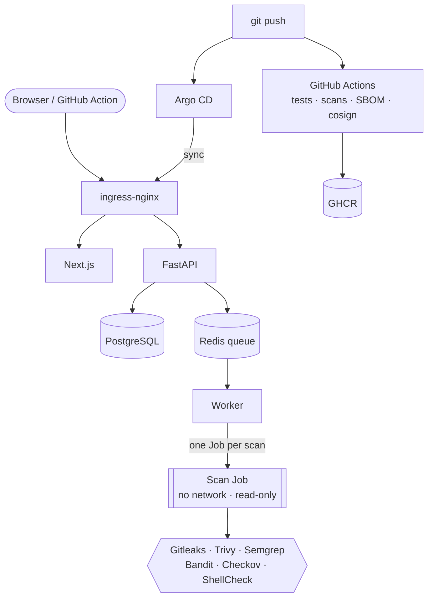
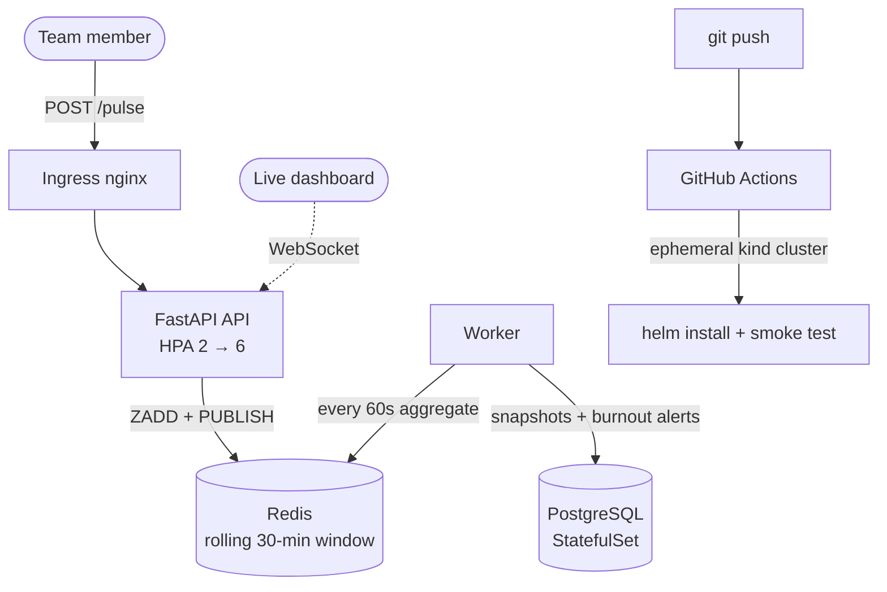

<p align="center">
  
</p>

<p align="center">
  <a href="https://www.linkedin.com/in/javid-mamedov-20061104c/"></a>
  <a href="mailto:javidmm.006@gmail.com"></a>
  <a href="https://github.com/jav1d006?tab=repositories"></a>
</p>

## `$ whoami`

I build delivery platforms where security is part of the pipeline, not a step after it. I design CI/CD that tests, scans, signs and ships software on every commit, and I run what I build: hardened containers, default-deny networking, monitoring and alerting included.

<p align="center">
  
</p>

<details>
<summary><code>$ kubectl get engineer javid -o yaml</code></summary>

```yaml
apiVersion: people/v1
kind: Engineer
metadata:
  name: javid-mamedov
  role: DevSecOps Engineer
spec:
  focus:         [kubernetes, gitops, secure-ci-cd, supply-chain-security]
  platform:      [kubernetes, helm, argo-cd, docker, linux]
  security:      [trivy, gitleaks, semgrep, checkov, sbom, cosign]
  observability: [prometheus, grafana, alertmanager]
  learning:      [aws, policy-as-code]
  openTo:        remote and international roles
```

</details>

## `$ cat pipeline.yml`

<p align="center">
  
</p>

Every change goes through the same gates. A failing test, a leaked secret or a HIGH/CRITICAL CVE stops the release; everything that ships is signed, has an SBOM and is deployed through GitOps.

## `$ kubectl get networkpolicy`

<p align="center">
  
</p>

Default-deny everywhere, explicit allows only. Containers run non-root on read-only filesystems with every capability dropped, and the jobs that touch untrusted code have no network and no credentials.

## `$ ls ~/projects --featured`

<table>
<tr>
<td width="50%" valign="top">

### [SecureShip](https://github.com/jav1d006/secureship)
**Self-hosted DevSecOps scanner**

Drop in a project, get a 0–100 security score from eight scanners, with SARIF, PDF and a GitHub Action for pull requests. Built to the standard it checks for.

- Every scan runs in an isolated Kubernetes Job: no network, no credentials, read-only source
- CI blocks HIGH/CRITICAL CVEs, publishes an SBOM and signs images with cosign
- GitOps with Argo CD, Prometheus alerts unit-tested with `promtool`


<details>
<summary><b>Architecture</b></summary>



</details>

</td>
<td width="50%" valign="top">

### [PulseBoard](https://github.com/jav1d006/PulseBoard)
**Real-time microservices on Kubernetes**

An anonymous team-health service (FastAPI, Redis, PostgreSQL, WebSockets) built as a vehicle for production-grade Kubernetes delivery.

- Helm chart with HPA (2 → 6 replicas), PodDisruptionBudget, StatefulSet and NetworkPolicies
- Every push spins up a disposable `kind` cluster in GitHub Actions, deploys the chart and runs smoke tests
- Cloud-agnostic: runs on any cluster, no cloud bill


<details>
<summary><b>Architecture</b></summary>



</details>

</td>
</tr>
</table>

### More work

| Project | What it is |
|---|---|
| [Linux-Hardening](https://github.com/jav1d006/Linux-Hardening) | Menu-driven Bash toolkit that applies Linux hardening baselines (kernel, disk, identity and authentication) with confirmation and logging |
| [Payloads-WAF](https://github.com/jav1d006/Payloads-WAF) | Curated JSON payload sets (SQLi, SSRF, SSTI, XXE, request smuggling and more) for authorised WAF and application security testing |
| [Gitlab-Local-Kubernetes](https://github.com/jav1d006/Gitlab-Local-Kubernetes) | Containerised app deployed to a local Kubernetes cluster through GitLab CI |
| [SAST-DAST-RealProject](https://github.com/jav1d006/SAST-DAST-RealProject) | Intentionally vulnerable app scanned with Snyk (SAST) and OWASP ZAP (DAST) in CI |

## `$ which --all tools`

<table>
<tr>
<td width="160"><b>Cloud & platform</b></td>
<td>


</td>
</tr>
<tr>
<td><b>CI/CD & IaC</b></td>
<td>


</td>
</tr>
<tr>
<td><b>Security</b></td>
<td>


</td>
</tr>
<tr>
<td><b>Observability</b></td>
<td>


</td>
</tr>
<tr>
<td><b>Languages & data</b></td>
<td>


</td>
</tr>
</table>

<details>
<summary><code>$ cat .secrets</code></summary>

```console
$ gitleaks detect --source . --redact
Finding:  AWS_SECRET_ACCESS_KEY=REDACTED
RuleID:   aws-secret-access-key
File:     .secrets
✖ 1 leak found. Commit blocked. Nice try.
```

</details>

<br/>

<p align="center">
  
</p>
